
<a href="README.md">English</a> · <b>Deutsch</b>

    
  <picture>
    <source media="(prefers-color-scheme: light)" srcset="docs/banner-de-light.png">
    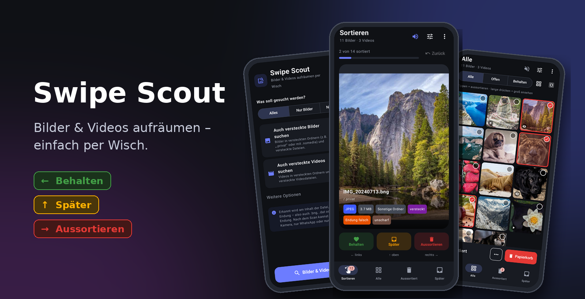
  </picture>

  <b>Finde alle Bilder und Videos auf deinem Android-Handy – auch versteckte, doppelte, ähnliche und unscharfe – 
  und räume sie mit einem Wisch auf.</b>

  

  
  
  
  
  

---

## Inhalt

- [Warum Swipe Scout?](#warum-swipe-scout)
- [Bildschirmfotos](#bildschirmfotos)
- [Installieren](#installieren)
- [So funktioniert's](#so-funktionierts)
- [Alle Funktionen](#alle-funktionen)
- [Sprachen & Design](#sprachen--design)
- [Datenschutz & Sicherheit](#datenschutz--sicherheit)
- [Häufige Fragen](#häufige-fragen)
- [Versionen](#versionen)
- [So ist die App aufgebaut](#so-ist-die-app-aufgebaut)
- [Lizenz](#lizenz)
- [Feedback & Hilfe](#feedback--hilfe)

## Warum Swipe Scout?

Normale Galerie-Apps zeigen nur, was Android ihnen meldet. Bilder in **versteckten Ordnern**
(`.privat`, Ordner mit `.nomedia`), **versteckte Dateien** oder Bilder mit **falscher Endung**
(`.bng`, `.dat`, ganz ohne Endung) fehlen dort. Swipe Scout durchsucht den ganzen Speicher,
erkennt Bilder und Videos **am Inhalt der Datei** – und du sortierst sie so schnell wie in einer Dating-App.

| | Normale Galerie | **Swipe Scout** |
|---|:---:|:---:|
| Versteckte Ordner & Dateien | ✗ | ✓ |
| Falsche oder fehlende Endung | ✗ | ✓ |
| Sortieren durch Wischen | ✗ | ✓ |
| Doppelte, ähnliche & unscharfe Fotos finden | teilweise | ✓ |
| Filter nach Quelle (Kamera, WhatsApp …) | teilweise | ✓ |
| Papierkorb mit frei einstellbarer Frist | teilweise | ✓ |
| Als ZIP sichern, in Ordner kopieren | ✗ | ✓ |

## Bildschirmfotos

> [!TIP]
> **Die App folgt automatisch dem Hell-/Dunkel-Modus deines Handys** (lässt sich auch fest auf hell oder dunkel stellen).
> Die Bildschirmfotos unten zeigen die dunkle Variante; ist dein eigenes Gerät auf hell gestellt, siehst du die helle.

<table>
  <tr>
    <td align="center" width="33%"><picture><source media="(prefers-color-scheme: light)" srcset="docs/screenshots/de/light/01-scan.png">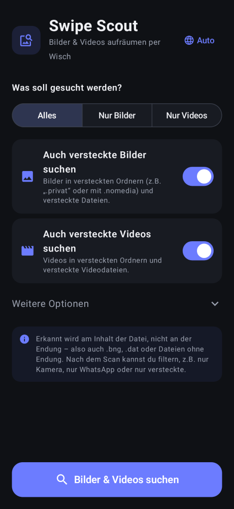</picture> <b>Scan einstellen</b> Alles, nur Bilder oder nur Videos – versteckte auf Wunsch dazu</td>
    <td align="center" width="33%"><picture><source media="(prefers-color-scheme: light)" srcset="docs/screenshots/de/light/02-sort.png">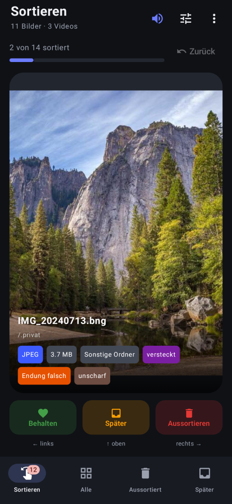</picture> <b>Sortieren</b> Eine Datei nach der anderen, mit Format, Größe und Quelle</td>
    <td align="center" width="33%"><picture><source media="(prefers-color-scheme: light)" srcset="docs/screenshots/de/light/03-swipe.png">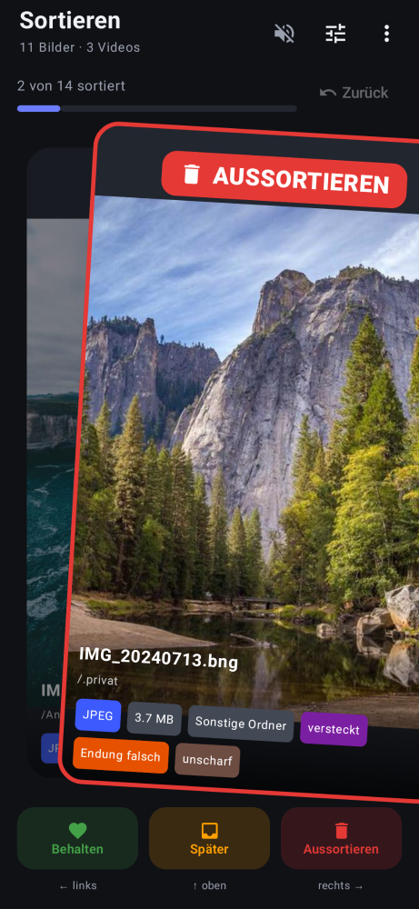</picture> <b>Wischen</b> Links behalten, rechts aussortieren, oben später</td>
  </tr>
  <tr>
    <td align="center" width="33%"><picture><source media="(prefers-color-scheme: light)" srcset="docs/screenshots/de/light/04-all.png">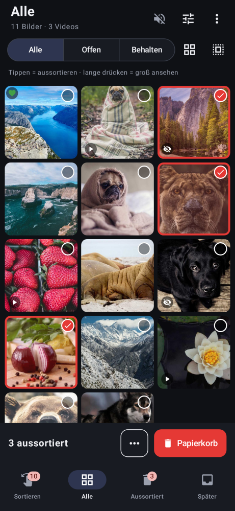</picture> <b>Übersicht</b> Alles im Raster, antippen zum Aussortieren</td>
    <td align="center" width="33%"><picture><source media="(prefers-color-scheme: light)" srcset="docs/screenshots/de/light/05-filter.png">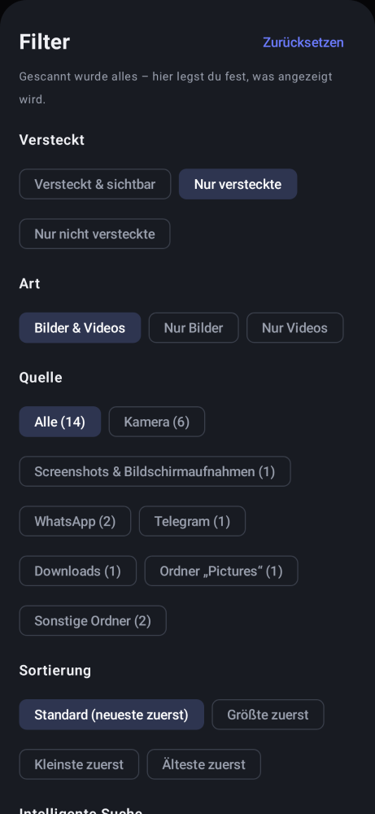</picture> <b>Filter</b> Versteckt, Art und Quelle</td>
    <td align="center" width="33%"><picture><source media="(prefers-color-scheme: light)" srcset="docs/screenshots/de/light/06-smart.png">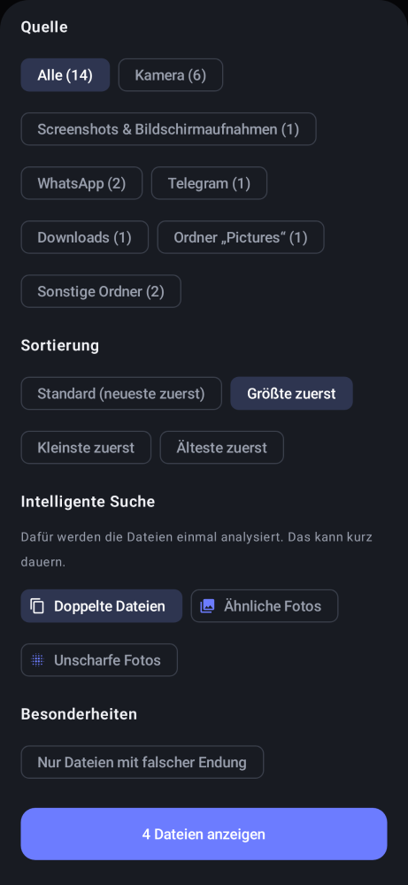</picture> <b>Sortierung & intelligente Suche</b> Größte zuerst, doppelte, ähnliche, unscharfe</td>
  </tr>
  <tr>
    <td align="center" width="33%"><picture><source media="(prefers-color-scheme: light)" srcset="docs/screenshots/de/light/07-duplicates.png">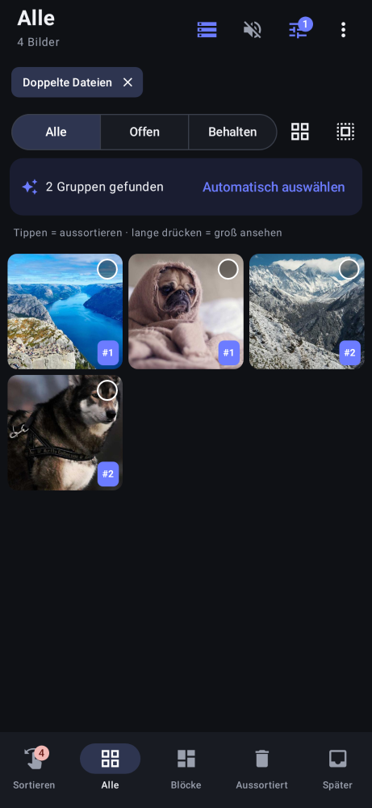</picture> <b>Doppelte finden</b> Gruppen mit Nummer, „Automatisch auswählen“</td>
    <td align="center" width="33%"><picture><source media="(prefers-color-scheme: light)" srcset="docs/screenshots/de/light/09-actions.png">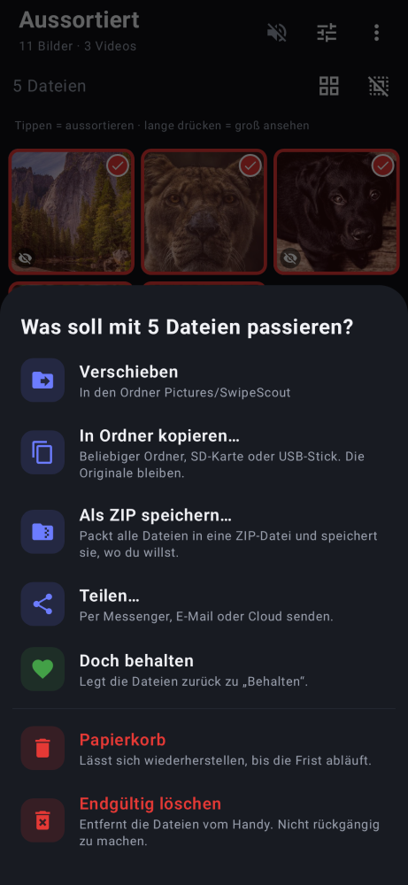</picture> <b>Aufräumen</b> Papierkorb, verschieben, kopieren, ZIP, teilen</td>
    <td align="center" width="33%"><picture><source media="(prefers-color-scheme: light)" srcset="docs/screenshots/de/light/10-trash.png">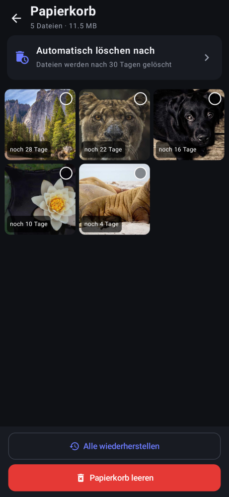</picture> <b>Papierkorb</b> Wiederherstellen, Frist frei einstellbar</td>
  </tr>
  <tr>
    <td align="center" width="33%"><picture><source media="(prefers-color-scheme: light)" srcset="docs/screenshots/de/light/11-stats.png">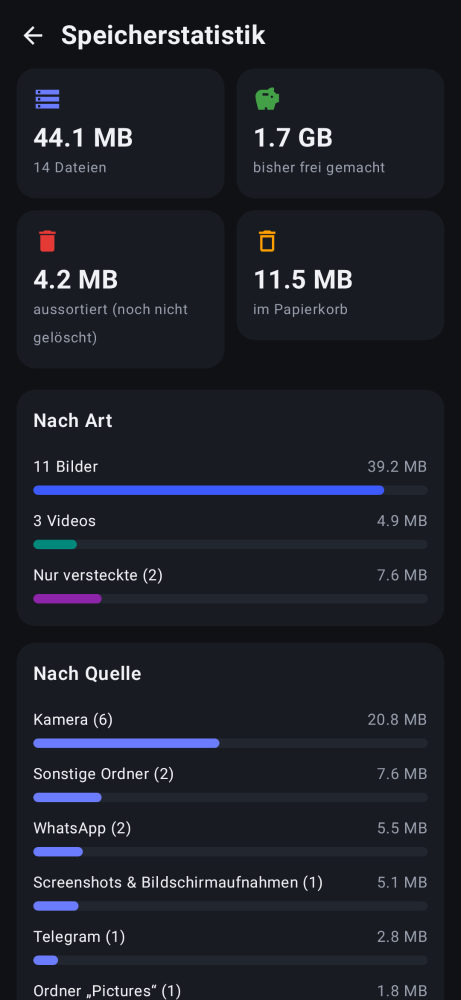</picture> <b>Speicherstatistik</b> Was wie viel Platz braucht</td>
    <td align="center" width="33%"><picture><source media="(prefers-color-scheme: light)" srcset="docs/screenshots/de/light/08-sorted-out.png">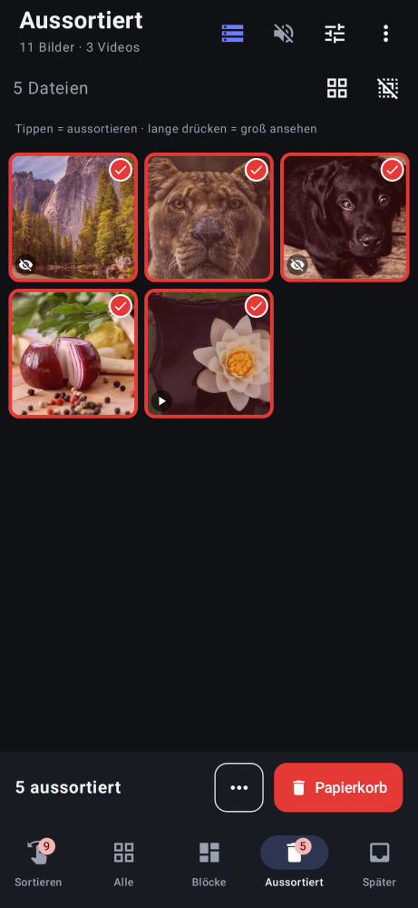</picture> <b>Aussortiert</b> Alles Aussortierte auf einen Blick</td>
  </tr>
</table>

## Installieren

1. **[SwipeScout.apk herunterladen](https://github.com/hyperflux22/SwipeScout/releases/latest/download/SwipeScout.apk)** – am besten direkt am Handy.
2. Die Datei öffnen. Android fragt, ob du **Apps aus unbekannten Quellen** erlauben willst → für den Browser bzw. Dateimanager erlauben.
3. **Installieren** tippen.
4. Swipe Scout öffnen → **Zugriff erlauben** → **„Zugriff auf alle Dateien“** einschalten → zurück.

> [!NOTE]
> Der Zugriff auf alle Dateien ist nötig, damit die App auch versteckte Ordner und Dateien mit falscher Endung findet.

## So funktioniert's

| Geste / Knopf | Bedeutung |
|---|---|
| ⬅️ **nach links wischen** | **Behalten** – die Datei bleibt, wie sie ist |
| ➡️ **nach rechts wischen** | **Aussortieren** – kommt in „Aussortiert“ |
| ⬆️ **nach oben wischen** | **Später** – wenn du dir noch nicht sicher bist |
| ↩️ **Zurück** | Macht die letzte Entscheidung rückgängig |
| 👆👆 **doppelt tippen** | Datei groß ansehen (Videos mit Steuerleiste) |
| 🔇 / 🔊 **Lautsprecher oben** | Ton für automatisch abgespielte Videos – bleibt gespeichert |
| 🎛️ **Regler oben** | Filter, Sortierung und intelligente Suche |
| ⋮ **Menü oben** | Neu scannen, Papierkorb, Speicherstatistik, Design, Sprache |

Gelöscht wird **nie** durch Wischen allein. Erst unter **Aussortiert** entscheidest du, was passiert –
und auch dann landet alles zuerst im **Papierkorb**.

## Alle Funktionen

<b>🔍 Scan</b>

- Auswahl oben: **Alles**, **Nur Bilder** oder **Nur Videos**.
- Darunter erscheint passend dazu **Auch versteckte Bilder suchen** und/oder **Auch versteckte Videos suchen**.
- **Weitere Optionen:** sehr kleine Dateien (unter 20 KB, meist Vorschaubilder oder Icons) überspringen.
- Erkennung am **Dateiinhalt**: Bilder (JPEG, PNG, GIF, WebP, BMP, HEIC, AVIF) und Videos (MP4, MOV, 3GP, MKV, WebM, AVI).

<b>👆 Sortieren & 🔊 Ton</b>

- Große Karte mit Name, Ordner, Format, Größe, Quelle und Markierungen **versteckt**, **Endung falsch**, **unscharf**.
- **Videos spielen automatisch** in Dauerschleife und werden genauso gewischt.
- Lautsprecher oben rechts: standardmäßig **durchgestrichen** (Ton aus). Antippen → Ton an, bleibt gespeichert.

<b>🎛️ Filter, Sortierung & intelligente Suche</b>

Gescannt wird immer alles – der Filter bestimmt nur, was angezeigt wird. Er gilt in allen Ansichten.

| Gruppe | Auswahl |
|---|---|
| Versteckt | Versteckt & sichtbar · Nur versteckte · Nur nicht versteckte |
| Art | Bilder & Videos · Nur Bilder · Nur Videos |
| Quelle | Kamera · Screenshots · WhatsApp · Telegram · Instagram · Snapchat · Facebook · Downloads · Bluetooth · Pictures · Movies · App-Ordner · Vorschaubilder · Sonstige |
| Sortierung | **Standard (neueste zuerst)** · Größte zuerst · Kleinste zuerst · Älteste zuerst |
| Intelligente Suche | **Doppelte Dateien** · **Ähnliche Fotos** · **Unscharfe Fotos** |
| Besonderheiten | Nur Dateien mit falscher Endung |

- **Doppelte Dateien:** exakt gleicher Inhalt (Prüfsumme), auch wenn Name, Ordner oder Endung verschieden sind.
- **Ähnliche Fotos:** Serienbilder und fast gleiche Aufnahmen.
- **Unscharfe Fotos:** verwackelte oder unscharfe Bilder.
- Gruppen tragen eine Nummer (#1, #2 …). **„Automatisch auswählen“** behält je Gruppe die beste Datei und sortiert den Rest aus.
- Die Analyse läuft einmal und wird gespeichert – beim nächsten Mal geht es sofort.

<b>🗂️ Aussortiert – was du mit den Dateien machen kannst</b>

| Aktion | Was passiert |
|---|---|
| 🗑️ **Papierkorb** | Wiederherstellbar, bis die Frist abläuft |
| 📁 **Verschieben** | In den Ordner `Pictures/SwipeScout` |
| 📋 **In Ordner kopieren…** | Beliebiger Ordner, SD-Karte oder USB-Stick – die Originale bleiben |
| 🗜️ **Als ZIP speichern…** | Alle Dateien in eine ZIP-Datei packen und speichern, wo du willst |
| 📤 **Teilen…** | Per Messenger, E-Mail oder Cloud senden |
| 💚 **Doch behalten** | Zurück zu „Behalten“ |
| ⛔ **Endgültig löschen** | Ohne Papierkorb, mit Nachfrage |

<b>♻️ Papierkorb</b>

- Gelöschte Dateien landen in einem versteckten Ordner und tauchen in keiner Galerie auf.
- Jede Datei zeigt, wie lange sie noch bleibt. Einzeln oder alle **wiederherstellen** oder **endgültig löschen**.
- **Automatisch löschen nach:** 5, 10, 20 oder 30 Tagen, 1, 2 oder 3 Monaten – oder **benutzerdefiniert** in Stunden, Tagen, Wochen oder Monaten.

<b>📊 Speicherstatistik</b>

- Gesamtgröße, **bisher frei gemachter Speicher**, aussortierte Dateien und Papierkorb.
- Balken nach Art (Bilder, Videos, versteckte) und nach Quelle (Kamera, WhatsApp …).

## Sprachen & Design

- **Sprache:** folgt automatisch dem Handy. Über ⋮ → Sprache (oder ab Android 13 in den Android-Einstellungen) änderbar.
  🇬🇧 English · 🇩🇪 Deutsch · 🇪🇸 Español · 🇫🇷 Français · 🇮🇹 Italiano · 🇵🇹 Português · 🇳🇱 Nederlands · 🇵🇱 Polski · 🇹🇷 Türkçe · 🇷🇺 Русский
- **Design:** folgt standardmäßig dem **Hell-/Dunkel-Modus des Handys**. Über ⋮ → Design fest auf **Hell** oder **Dunkel** stellbar.

  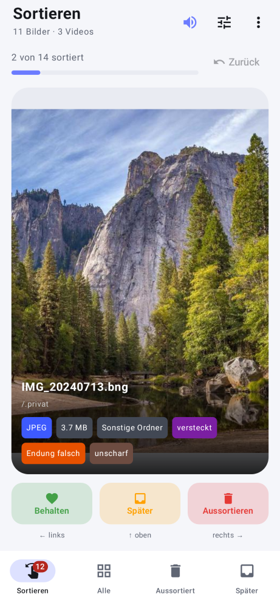&nbsp;&nbsp;&nbsp;
  

## Datenschutz & Sicherheit

- 📴 **100 % offline.** Die App hat keine Internet-Berechtigung und schickt nichts irgendwohin.
- 🚫 **Keine Werbung, kein Tracking, kein Konto.**
- 🗑️ **Nichts wird ohne dein Zutun gelöscht.** Wischen markiert nur, Löschen geht zuerst in den Papierkorb.

## Häufige Fragen

<b>Warum findet die App mehr Bilder als meine Galerie?</b>

Galerie-Apps zeigen nur Dateien, die Android als Bild kennt. Versteckte Ordner, Ordner mit `.nomedia`
und Dateien mit falscher Endung fehlen dort. Swipe Scout liest die ersten Bytes jeder Datei und erkennt so das echte Format.

<b>Kann ich versteckte Bilder von anderen Apps kaputt machen?</b>

Nur wenn du sie löschst oder verschiebst. Swipe Scout benennt keine Dateien um und ändert nichts, solange du nur wischst.
Im Papierkorb lassen sich Dateien an ihren alten Platz zurücklegen.

<b>Wann wird der Papierkorb geleert?</b>

Abgelaufene Dateien werden beim Öffnen der App endgültig gelöscht. Wer die App lange nicht öffnet, behält sie entsprechend länger.

<b>Warum ist der Ordner <code>Android/data</code> nicht dabei?</b>

Seit Android 11 erlaubt Android keiner App mehr den Zugriff auf diesen Ordner.

## Versionen

| Version | Was neu ist |
|---|---|
| 3.1 | Neues App-Icon, „Über“ mit Link, Kästchen nicht mehr abgeschnitten |
| **3.0** | Papierkorb mit einstellbarer Frist, doppelte/ähnliche/unscharfe Fotos, Sortierung, Speicherstatistik, Hell/Dunkel |
| 2.1 | Android 16, Leiste „x aussortiert“ repariert |
| **2.0** | Neuer Name Swipe Scout, 10 Sprachen, ZIP/Kopieren/Teilen |
| 1.2 | Übersichtlichere Oberfläche, Ton-Schalter, Scan-Auswahl |
| 1.1 | Videos, Filter nach Quelle |
| **1.0** | Erste Version |

Große Änderungen erhöhen die erste Zahl (2.0 → 3.0), kleine die zweite (3.0 → 3.1).
Alle Details im [Änderungsverlauf](CHANGELOG.de.md), jede Version als APK unter
[Releases](https://github.com/hyperflux22/SwipeScout/releases).

## So ist die App aufgebaut

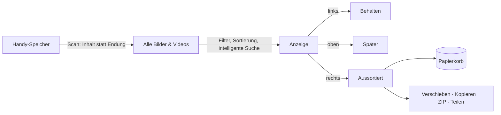

## Lizenz

Swipe Scout ist **kostenlos nutzbar**. Du darfst die App **unverändert und kostenlos** weitergeben, mit dem Hinweis,
dass sie von Swipe Scout von hyperflux22 stammt. Verändern, Verkaufen oder ein Einsatz für schädliche Zwecke ist
**nicht erlaubt**. Alle Details: [Lizenz (Deutsch)](LICENSE.de.md) · [LICENSE (English, verbindlich)](LICENSE).

## Feedback & Hilfe

Fehler gefunden oder eine Idee? [Meldung erstellen](https://github.com/hyperflux22/SwipeScout/issues/new/choose) – auf Deutsch oder Englisch.

Beispielfotos in den Bildschirmfotos: <a href="https://picsum.photos">Lorem Picsum</a> / Unsplash.
