
<b>English</b> · <a href="README.de.md">Deutsch</a>

    
  <picture>
    <source media="(prefers-color-scheme: light)" srcset="docs/banner-en-light.png">
    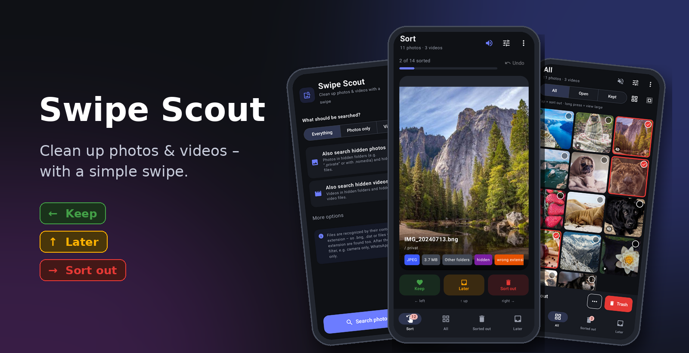
  </picture>

  <b>Find every photo and video on your Android phone – even hidden, duplicate, similar and blurry ones – 
  and clean them up with a swipe.</b>

  

  
  
  
  
  

---

## Contents

- [Why Swipe Scout?](#why-swipe-scout)
- [Screenshots](#screenshots)
- [Windows & Mac](#windows--mac)
- [Install](#install)
- [How it works](#how-it-works)
- [All features](#all-features)
- [Languages & appearance](#languages--appearance)
- [Privacy & safety](#privacy--safety)
- [FAQ](#faq)
- [Versions](#versions)
- [How the app is built](#how-the-app-is-built)
- [License](#license)
- [Feedback & support](#feedback--support)

## Why Swipe Scout?

Regular gallery apps only show what Android reports to them. Photos in **hidden folders**
(`.private`, folders with `.nomedia`), **hidden files** or photos with a **wrong extension**
(`.bng`, `.dat`, no extension at all) are missing there. Swipe Scout scans the whole storage,
recognizes photos and videos **by their content** – and lets you sort them as fast as in a dating app.

| | Regular gallery | **Swipe Scout** |
|---|:---:|:---:|
| Hidden folders & files | ✗ | ✓ |
| Wrong or missing extension | ✗ | ✓ |
| Sort by swiping | ✗ | ✓ |
| Find duplicate, similar & blurry photos | partly | ✓ |
| Filter by source (camera, WhatsApp …) | partly | ✓ |
| Trash with a freely adjustable time limit | partly | ✓ |
| Save as ZIP, copy to a folder | ✗ | ✓ |

## Screenshots

> [!TIP]
> **The app follows your phone’s light/dark setting** automatically (can also be set to light or dark by hand).
> The screenshots below show the dark version; if your own device is set to light mode, you see the light version.

<table>
  <tr>
    <td align="center" width="33%"><picture><source media="(prefers-color-scheme: light)" srcset="docs/screenshots/en/light/01-scan.png">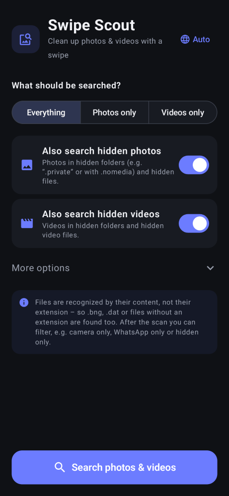</picture> <b>Set up the scan</b> Everything, photos only or videos only – hidden ones on request</td>
    <td align="center" width="33%"><picture><source media="(prefers-color-scheme: light)" srcset="docs/screenshots/en/light/02-sort.png">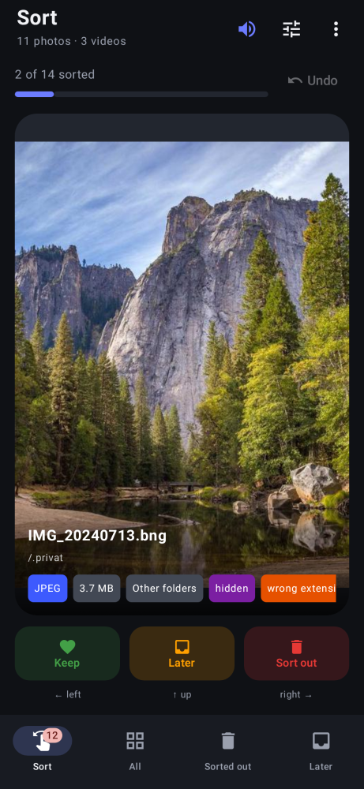</picture> <b>Sort</b> One file at a time, with format, size and source</td>
    <td align="center" width="33%"><picture><source media="(prefers-color-scheme: light)" srcset="docs/screenshots/en/light/03-swipe.png">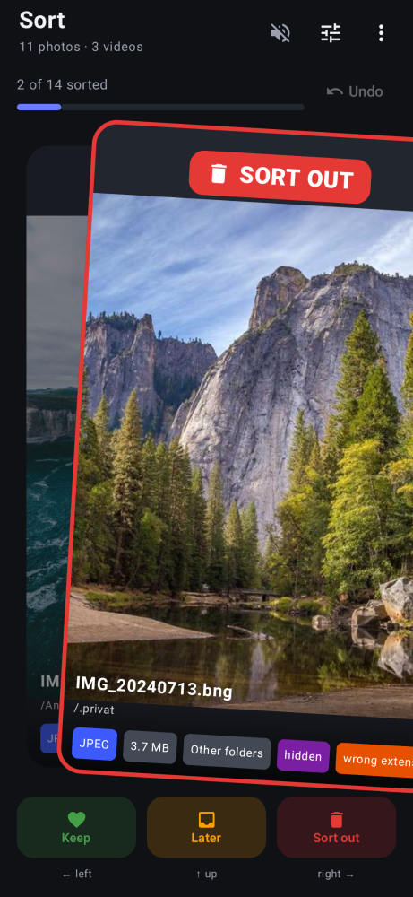</picture> <b>Swipe</b> Left keep, right sort out, up later</td>
  </tr>
  <tr>
    <td align="center" width="33%"><picture><source media="(prefers-color-scheme: light)" srcset="docs/screenshots/en/light/04-all.png">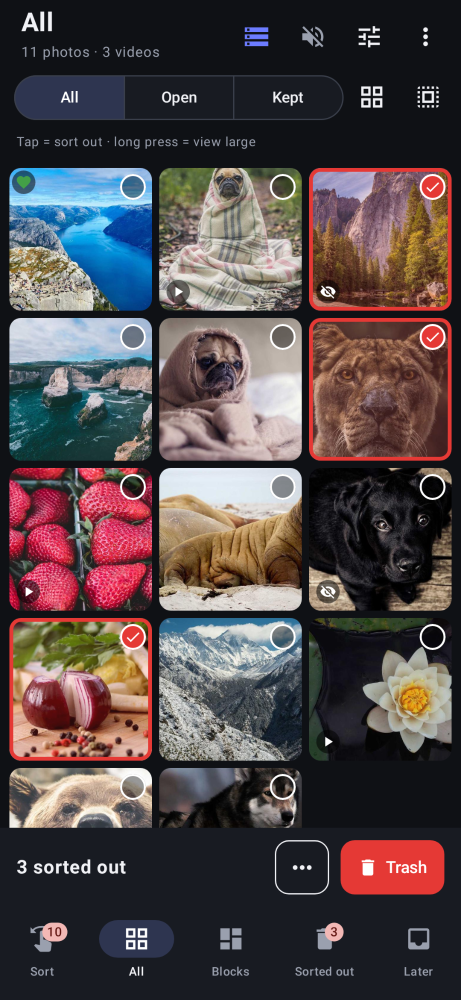</picture> <b>Overview</b> Everything in a grid, tap to sort out</td>
    <td align="center" width="33%"><picture><source media="(prefers-color-scheme: light)" srcset="docs/screenshots/en/light/05-filter.png">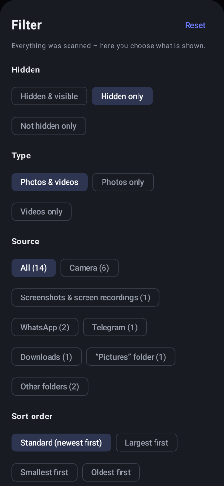</picture> <b>Filter</b> Hidden, type and source</td>
    <td align="center" width="33%"><picture><source media="(prefers-color-scheme: light)" srcset="docs/screenshots/en/light/06-smart.png">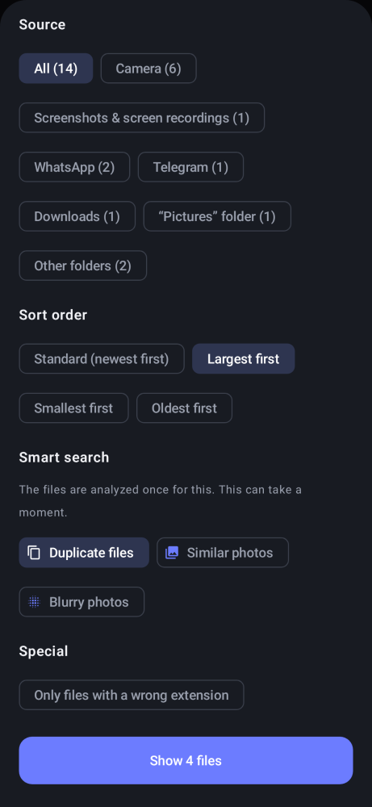</picture> <b>Sort order & smart search</b> Largest first, duplicates, similar, blurry</td>
  </tr>
  <tr>
    <td align="center" width="33%"><picture><source media="(prefers-color-scheme: light)" srcset="docs/screenshots/en/light/07-duplicates.png">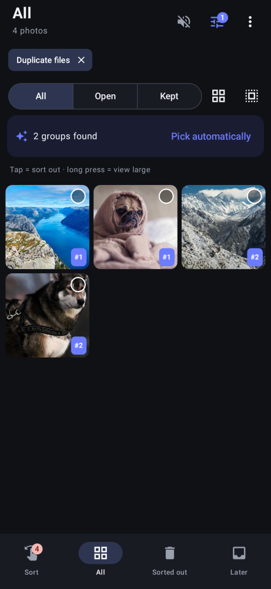</picture> <b>Find duplicates</b> Numbered groups, “Pick automatically”</td>
    <td align="center" width="33%"><picture><source media="(prefers-color-scheme: light)" srcset="docs/screenshots/en/light/09-actions.png">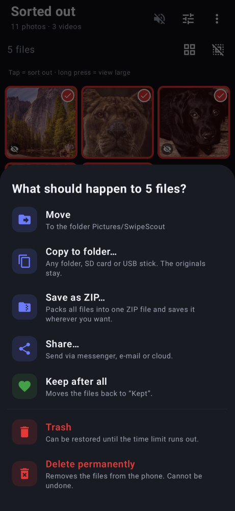</picture> <b>Clean up</b> Trash, move, copy, ZIP, share</td>
    <td align="center" width="33%"><picture><source media="(prefers-color-scheme: light)" srcset="docs/screenshots/en/light/10-trash.png">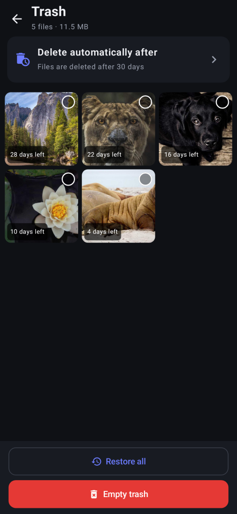</picture> <b>Trash</b> Restore, time limit fully adjustable</td>
  </tr>
  <tr>
    <td align="center" width="33%"><picture><source media="(prefers-color-scheme: light)" srcset="docs/screenshots/en/light/11-stats.png">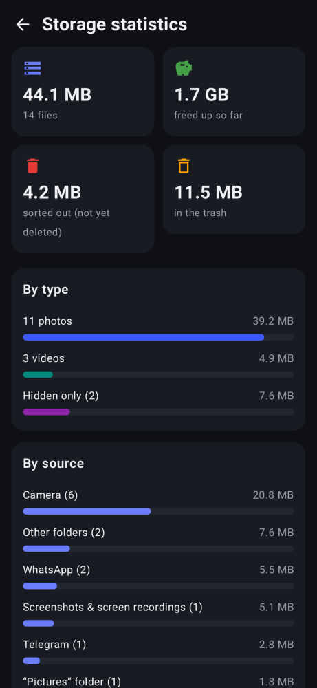</picture> <b>Storage statistics</b> What takes how much space</td>
    <td align="center" width="33%"><picture><source media="(prefers-color-scheme: light)" srcset="docs/screenshots/en/light/08-sorted-out.png">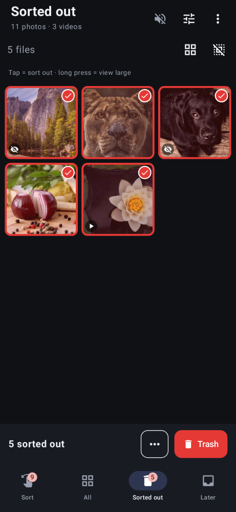</picture> <b>Sorted out</b> Everything sorted out at a glance</td>
  </tr>
</table>

## Windows & Mac

Swipe Scout also runs on **Windows** and **Mac** – with all features of the phone app, plus things that are especially handy on a computer.

<table>
  <tr>
    <td align="center" width="50%"><picture><source media="(prefers-color-scheme: light)" srcset="docs/screenshots/desktop/en/light/1-sort.png">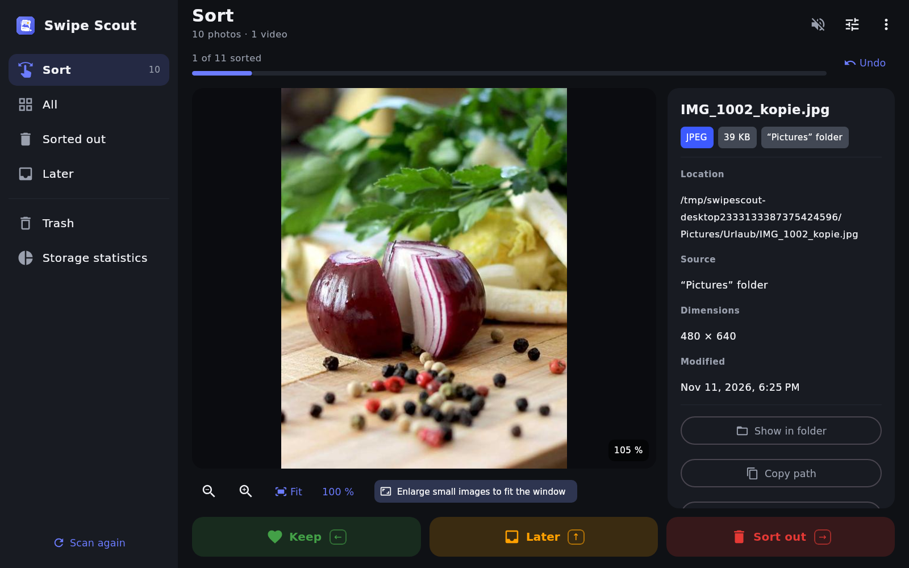</picture> <b>Sort with the arrow keys</b> Large view, full path, “Show in folder”</td>
    <td align="center" width="50%"><picture><source media="(prefers-color-scheme: light)" srcset="docs/screenshots/desktop/en/light/2-all.png">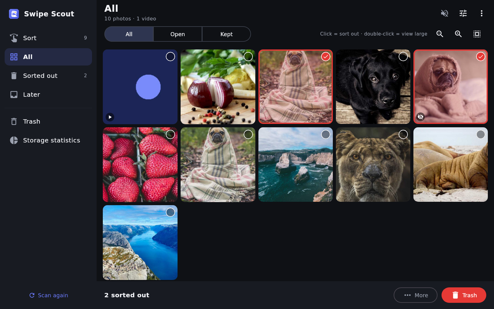</picture> <b>Overview</b> Adjustable tile size, click to sort out</td>
  </tr>
  <tr>
    <td align="center" width="50%"><picture><source media="(prefers-color-scheme: light)" srcset="docs/screenshots/desktop/en/light/4-stats.png">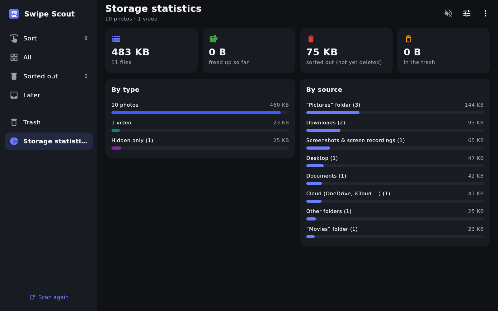</picture> <b>Storage statistics</b> What takes how much space</td>
    <td align="center" width="50%"><picture><source media="(prefers-color-scheme: light)" srcset="docs/screenshots/desktop/en/light/0-scan.png">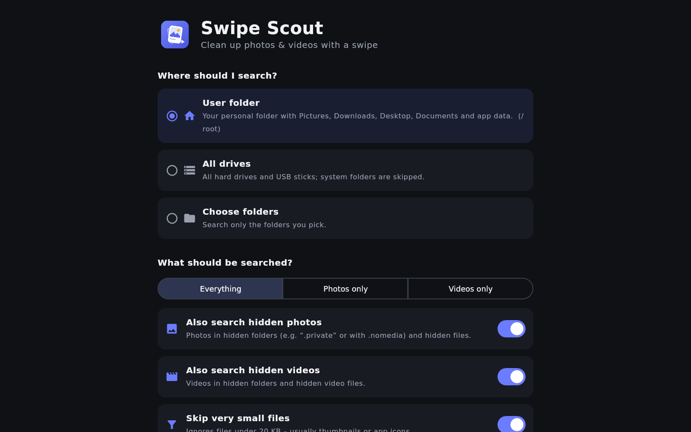</picture> <b>Choose where to search</b> User folder, all drives or your own folders</td>
  </tr>
</table>

| Key / mouse | Action |
|---|---|
| **←** | Keep |
| **→** | Sort out |
| **↑** | Later |
| **↓** or **Ctrl+Z** | Undo |
| **Space** | Play / pause video |
| **+ / −** or **mouse wheel** | Zoom in / out |
| **0** | Fit to window |
| **1** | Original size (100 %) |
| **Drag** | Move a zoomed image |
| **Double-click** | Switch between 100 % and fit |

- **Fit to window:** small images are reliably enlarged to the window size – also after resizing the window. Can be switched off (then at most original size).
- **Always visible:** full path, source, dimensions and date, plus **Show in folder**, **Copy path** and **Open with default app**.
- **Where to search:** your user folder, **all drives** (system folders are skipped) or **folders you choose**. Hidden files are found by the dot *and* by the Windows “hidden” attribute.
- **Videos** (MP4, MOV, MKV, WebM, 3GP, AVI) play inside the app; **HEIC/AVIF** photos open too.

### Install on a computer

- **Windows:** download **`SwipeScout.msi`** from [Releases](https://github.com/hyperflux22/SwipeScout/releases/latest) and open it. Windows may show “Windows protected your PC” – click **More info → Run anyway** (the installer is not signed with a paid certificate).
- **Mac (Apple Silicon, M1 or newer):** download **`SwipeScout.dmg`**, open it and drag **Swipe Scout** into **Applications**. On first start: **right-click the app → Open → Open** (or System Settings → Privacy & Security → “Open anyway”).

### Updates

On first start, the app asks whether it may look for updates. If yes, it checks the public repository briefly at every start; nothing about you is sent.
- **Windows & Mac:** “New version available” → **Update now** – the app downloads, installs and restarts itself.
- **Android:** “New version available” → **Update now** – the app downloads the new version and opens the Android installer; tap **Install** once, then **Open**. (Android does not allow apps outside the Play Store to replace themselves without this one tap.)

## Install

1. **[Download SwipeScout.apk](https://github.com/hyperflux22/SwipeScout/releases/latest/download/SwipeScout.apk)** – ideally right on your phone.
2. Open the file. Android asks whether to allow **apps from unknown sources** → allow it for your browser or file manager.
3. Tap **Install**.
4. Open Swipe Scout → **Allow access** → turn on **“Access to all files”** → go back.

> [!NOTE]
> Access to all files is required so the app can also find hidden folders and files with a wrong extension.

## How it works

| Gesture / button | Meaning |
|---|---|
| ⬅️ **swipe left** | **Keep** – the file stays as it is |
| ➡️ **swipe right** | **Sort out** – goes to “Sorted out” |
| ⬆️ **swipe up** | **Later** – when you are not sure yet |
| ↩️ **Undo** | Reverts the last decision |
| 👆👆 **double tap** | View the file large (videos with controls) |
| 🔇 / 🔊 **speaker at the top** | Sound for auto-playing videos – remembered |
| 🎛️ **sliders at the top** | Filter, sort order and smart search |
| ⋮ **menu at the top** | Scan again, trash, storage statistics, appearance, language |

Swiping **never** deletes anything. Only under **Sorted out** do you decide what happens – and even then everything goes to the **trash** first.

## All features

<b>🔍 Scan</b>

- Choose at the top: **Everything**, **Photos only** or **Videos only**.
- Below, **Also search hidden photos** and/or **Also search hidden videos** appear.
- **More options:** skip very small files (under 20 KB, usually thumbnails or icons).
- Detection by **file content**: photos (JPEG, PNG, GIF, WebP, BMP, HEIC, AVIF) and videos (MP4, MOV, 3GP, MKV, WebM, AVI).

<b>👆 Sorting & 🔊 sound</b>

- Large card with name, folder, format, size, source and **hidden**, **wrong extension**, **blurry** labels.
- **Videos play automatically** in a loop and are swiped the same way.
- Speaker at the top right: **crossed out** by default (sound off). Tap → sound on, remembered.

<b>🎛️ Filter, sort order & smart search</b>

Everything is always scanned – the filter only decides what is shown, in every view.

| Group | Options |
|---|---|
| Hidden | Hidden & visible · Hidden only · Not hidden only |
| Type | Photos & videos · Photos only · Videos only |
| Source | Camera · Screenshots · WhatsApp · Telegram · Instagram · Snapchat · Facebook · Downloads · Bluetooth · Pictures · Movies · App folders · Thumbnails · Other |
| Sort order | **Standard (newest first)** · Largest first · Smallest first · Oldest first |
| Smart search | **Duplicate files** · **Similar photos** · **Blurry photos** |
| Special | Only files with a wrong extension |

- **Duplicate files:** exactly the same content (checksum), even with a different name, folder or extension.
- **Similar photos:** burst shots and near-identical pictures.
- **Blurry photos:** shaky or out-of-focus pictures.
- Groups are numbered (#1, #2 …). **“Pick automatically”** keeps the best file of each group and sorts out the rest.
- The analysis runs once and is saved – next time it is instant.

<b>🗂️ Sorted out – what you can do with the files</b>

| Action | What happens |
|---|---|
| 🗑️ **Trash** | Can be restored until the time limit runs out |
| 📁 **Move** | To the folder `Pictures/SwipeScout` |
| 📋 **Copy to folder…** | Any folder, SD card or USB stick – the originals stay |
| 🗜️ **Save as ZIP…** | Pack all files into one ZIP file and save it wherever you want |
| 📤 **Share…** | Send via messenger, e-mail or cloud |
| 💚 **Keep after all** | Back to “Kept” |
| ⛔ **Delete permanently** | Without the trash, with confirmation |

<b>♻️ Trash</b>

- Deleted files go to a hidden folder and do not show up in any gallery.
- Every file shows how long it stays. **Restore** or **delete permanently**, one by one or all at once.
- **Delete automatically after:** 5, 10, 20 or 30 days, 1, 2 or 3 months – or **custom** in hours, days, weeks or months.

<b>📊 Storage statistics</b>

- Total size, **space freed up so far**, sorted-out files and trash.
- Bars by type (photos, videos, hidden) and by source (camera, WhatsApp …).

## Languages & appearance

- **Language:** follows your phone automatically. Change it via ⋮ → Language (or, on Android 13+, in Android Settings).
  🇬🇧 English · 🇩🇪 Deutsch · 🇪🇸 Español · 🇫🇷 Français · 🇮🇹 Italiano · 🇵🇹 Português · 🇳🇱 Nederlands · 🇵🇱 Polski · 🇹🇷 Türkçe · 🇷🇺 Русский
- **Appearance:** follows your **phone’s light/dark mode** by default. Set it to **Light** or **Dark** via ⋮ → Appearance.

  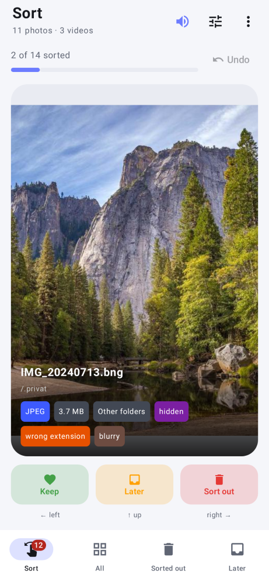&nbsp;&nbsp;&nbsp;
  

## Privacy & safety

- 📴 **Offline by default.** The app only goes online for the update check – and only if you allowed it on first start. Nothing about you or your files is sent.
- 🚫 **No ads, no tracking, no account.**
- 🗑️ **Nothing is deleted without you.** Swiping only marks files; deleting goes to the trash first.

## FAQ

<b>Why does the app find more photos than my gallery?</b>

Gallery apps only show files Android knows as images. Hidden folders, folders with `.nomedia`
and files with a wrong extension are missing there. Swipe Scout reads the first bytes of each file to detect the real format.

<b>Can I break hidden images of other apps?</b>

Only if you delete or move them. Swipe Scout never renames files and changes nothing while you just swipe.
Files in the trash can be put back where they were.

<b>When is the trash emptied?</b>

Expired files are deleted when you open the app. If you do not open it for a long time, they stay a bit longer.

<b>Why is the <code>Android/data</code> folder not included?</b>

Since Android 11, Android no longer allows any app to access this folder.

## Versions

| Version | What's new |
|---|---|
| **4.0** | **Windows & Mac version**, arrow keys, zoom and fit-to-window; update check with “Update now” on all platforms |
| 3.2 | Maintenance, no visible changes |
| 3.1 | New app icon, “About” with link, labels no longer cut off |
| **3.0** | Trash with adjustable time limit, duplicate/similar/blurry photos, sort order, storage statistics, light/dark |
| 2.1 | Android 16, fixed the “x sorted out” bar |
| **2.0** | New name Swipe Scout, 10 languages, ZIP/copy/share |
| 1.2 | Clearer interface, sound switch, scan choice |
| 1.1 | Videos, filter by source |
| **1.0** | First version |

Big changes raise the first number (2.0 → 3.0), small ones the second (3.0 → 3.1).
Details in the [changelog](CHANGELOG.md), every version as an APK under
[Releases](https://github.com/hyperflux22/SwipeScout/releases).

## How the app is built

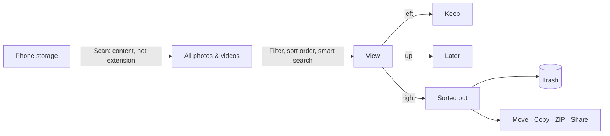

## License

Swipe Scout is **free to use**. You may pass the app on **unchanged and free of charge**, with a note that it comes
from Swipe Scout by hyperflux22. Changing it, selling it or using it for harmful purposes is **not allowed**.
All details: [LICENSE](LICENSE) · [German translation](LICENSE.de.md).

## Feedback & support

Found a bug or have an idea? [Open an issue](https://github.com/hyperflux22/SwipeScout/issues/new/choose) – in English or German.

Sample photos in the screenshots: <a href="https://picsum.photos">Lorem Picsum</a> / Unsplash.
